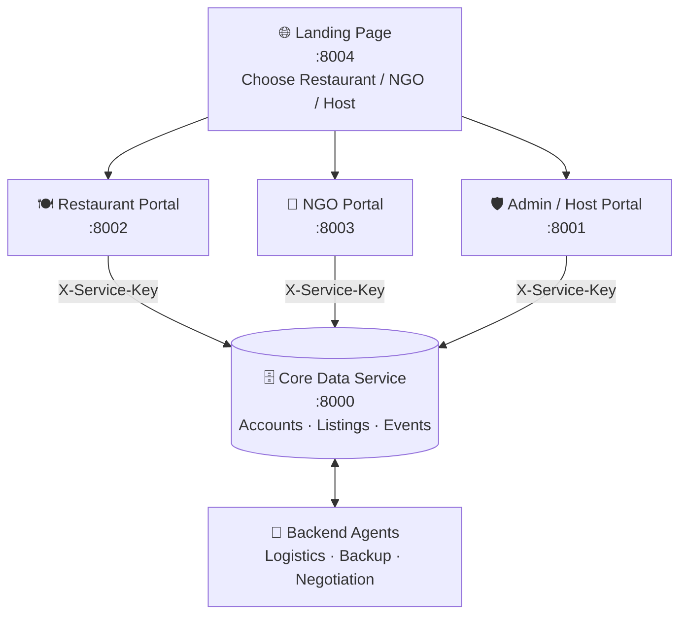
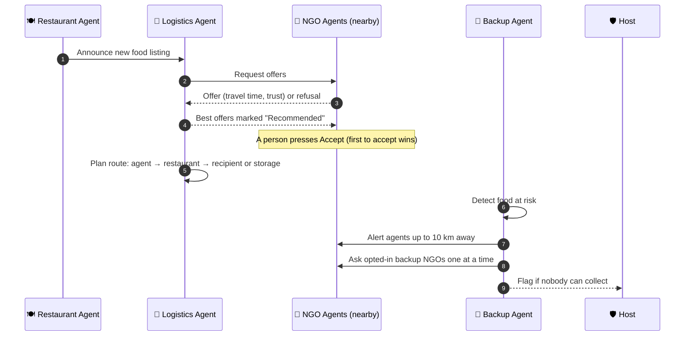
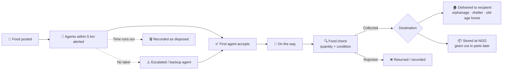
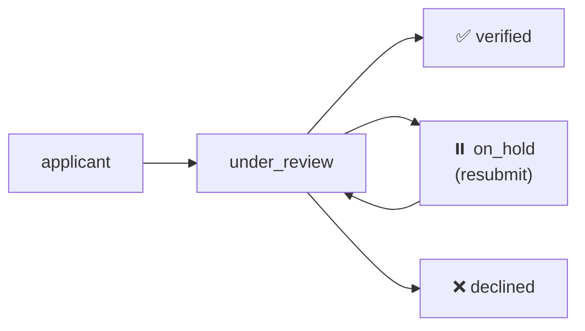

<div align="center">

# 🍲 Multi-Agent Food Redistribution System

### Surplus food from restaurants → NGOs → people who need it, supervised by a host.


[Overview](#-overview) • [Architecture](#-architecture) • [Food Lifecycle](#-food-lifecycle) • [Features](#-features-by-phase) • [Quick Start](#-quick-start) • [Sign-in Options](#-sign-in-options) • [Testing](#-testing--demo)

</div>

---

## 📖 Overview

This prototype connects **restaurants with surplus food** to **NGOs that collect and distribute it**, with a **host** supervising the whole process. Backend agents rank collectors, plan routes, negotiate offers, and back each other up, while people always make the final decision (pressing *Accept*).

The phased roadmap is in [PHASES.md](PHASES.md).

| Role | What they do |
|---|---|
| 🍽️ **Restaurant** | Posts surplus food and tracks who is collecting it. |
| 🤝 **NGO / Agent** | Receives nearby alerts, accepts pickups, delivers or stores food. |
| 🛡️ **Host** | Verifies accounts, monitors the live map and agents, reviews trust scores. |

---

## 🏗️ Architecture



**Design principles**

- **Three separate portals.** Each is its own FastAPI app with its own frontend, session cookie, and signing secret. A session from one portal is rejected by the others.
- **Core data service.** The only owner of shared records. Portals call it with a per-portal service key, and the core enforces data ownership:
  - A portal only signs in accounts of its own role.
  - Restaurant and NGO portals can only read accounts of their own role.
  - Only the admin portal can list all accounts and the event log.
- **Host accounts** are created by the project team (`scripts/create_host.py`); the admin portal has no sign-up.
- **Event log.** Every registration, login, and failed login is recorded. Later phases feed the map and agents from it.

### Multi-agent interaction



---

## 🔄 Food Lifecycle



**Account verification flow**



---

## ✨ Features by Phase

<details open>
<summary><b>Phase 1 · Foundation</b></summary>

- Three portals, a core data service, host accounts, and a full event log (see [Architecture](#-architecture)).
</details>

<details>
<summary><b>Phase 2 · Onboarding and verification</b></summary>

- Restaurant and NGO applicants complete a profile (including latitude/longitude), upload evidence, and submit.
- **Uploads:** max 5 MB; the real type is detected from content (JPEG / PNG / WEBP / PDF). Files are served only to their owner and the host, with `nosniff` and a sandboxing CSP.
- **Host review queue:** evidence viewer, verify / hold / decline (a note is required to hold or decline), review history, NGO agent directory, and badges.

| Badge | Meaning |
|---|---|
| 🔵 Verified | Verified restaurant |
| 🟠 Unverified / On hold | Restaurant not yet verified |
| 🟢 Verified NGO | Verified NGO |
| 🟢 Available / 🔴 Unavailable | NGO agent status |
</details>

<details>
<summary><b>Phase 3 · Food listings and nearby alerts</b></summary>

- A verified restaurant posts food: type, quantity (portions/kg), veg/non-veg, condition, preparation and expiry time, a photo, and pickup notes.
- Verified, available NGO agents **within 5 km** are alerted. The "Nearby food" feed refreshes every 15 s and shows distance and time left.
- **First to accept gets the pickup.** The restaurant sees who is collecting, and the agent gets the restaurant's contact details.
- The host's **Food listings** tab shows every listing, its status, and how many agents were alerted.
</details>

<details>
<summary><b>Phase 4 · Pickup, food check, delivery and storage</b></summary>

- The agent marks "I'm on my way", records a food check (quantity received and condition), then collects or rejects the food.
- Collected food is delivered to one of the NGO's recipients (with the receiver's name) or stored at the NGO and given out later in parts. Expired food is recorded as disposed.
- The restaurant and host see the full history of each listing; the host has an **NGO storage** tab.
</details>

<details>
<summary><b>Phase 5 · Host live map</b></summary>

- **Live map** tab (OpenStreetMap) shows restaurants, open food, pickups in progress with the agent's movement trail, and NGO agents (live, last known, or at their NGO base). Refreshes every 10 s; clicking an agent opens a details panel.
- NGO agents share location with **Start sharing my location** (only while Available or on a pickup).
- Requires an internet connection to load map tiles.
</details>

<details>
<summary><b>Phase 6 · Multi-agent layer</b></summary>

Two backend agents run every 30 seconds and exchange messages (all logged):

- **Logistics agent:** ranks the best collectors for new food (shown as "Recommended for you" in the NGO feed) and plans each pickup route (agent → restaurant → nearest recipient or NGO storage) with a directions link.
- **Backup agent:** spots food at risk, alerts agents up to 10 km away, asks opted-in backup NGOs one at a time to collect and store it, and flags the host if nobody can.

NGOs can opt in to backup collections and accept or decline requests. The host has an **Agents** tab, an **Escalate** button for open food, and **Run agents now**.
</details>

<details>
<summary><b>Phase 7 · Trust scores and agent negotiation</b></summary>

- **Trust (host only, decision support):** every NGO and restaurant gets a 0–100 score (new accounts start at 50) with a confidence level, plain-language reasons, and review flags. The host can add notes.
- **Negotiation (Contract-Net):** the restaurant's agent announces food, the logistics agent asks nearby NGO agents for offers, each answers with an offer (travel time, trust) or a refusal, and the best offers become "Recommended". People still press Accept. Every round is visible in the host's Agents tab.
</details>

<details>
<summary><b>Phase 8 · Simulator and evaluation</b></summary>

- A pretend city (never real data) replays thousands of food posts in seconds and compares four collector-selection strategies: **Random**, **Nearest agent**, **Our agents**, and **Our agents without trust**.
- **Host portal → Simulation tab:** change settings, run, view charts and a table, download a CSV.
- **CLI:** `python -m simulation.run` (e.g. `--ngos 30 --runs 5`). Reports are saved in `data/sim_reports/`.
</details>

<details>
<summary><b>Phase 9 · Learned dispatch (reinforcement learning)</b></summary>

- A learning dispatcher practises in the simulator (policy gradient) and learns how much travel time, trust, fairness, and urgency should count when choosing who is offered food first.
- **Host portal → Agents → Learned dispatch:** train (about 20 s), read the test result on unseen cities, and switch it on or off. It is **off by default** and falls back to the normal rule if untrained.
- **CLI:** `python -m simulation.train` (saves `data/learned_policy.json`).
</details>

<details>
<summary><b>Phase 10 · Hardening and integration</b></summary>

**Notifications.** A bell in every portal's header shows a red unread count for:

| Audience | Events |
|---|---|
| NGO | New nearby food |
| Restaurant | Pickup accepted, on the way, collected or rejected, given back, delivered, stored, or expired |
| Applicant | Account approved, held, or declined |
| Host | New applications; food needing attention |
| Backup collector | Backup requests |

**Privacy.** Phone numbers are shared only while a pickup is in progress. Old data is deleted automatically:

| Data | Retention |
|---|---|
| Movement trails | 7 days |
| Stale positions | 1 day |
| Notifications | 30 days if read, 90 if unread |
| Agent messages and sign-in records | 90 days |

Host portal → **Privacy** tab: read the rules, run the clean-up, and export or erase one account's data.

**Security.** Rate limits on repeated sign-ins and registrations, security headers, cross-site requests refused, and no caching of personal data. See [SECURITY.md](SECURITY.md) for the full review.

**Deployment.** `scripts/setup.py` (one-time setup), `.env.example` (all settings), and `python -m scripts.health` (checks all five services).

**End-to-end demo.** `python -m scripts.demo --host-email <host email>` runs the whole story (13 checked steps) against the running app. The same story is the automated test `tests/test_end_to_end.py`.
</details>

---

## 🚀 Quick Start

Open the project folder in VS Code, then open a terminal (**Terminal → New Terminal** or `Ctrl + \``) and run these in order.

**1. Go to the project folder** (skip if VS Code already opened it)

```bash
cd "path/to/multi-agent-redistribution-system"
```

**2. Install the packages** (first time only)

```bash
pip install -r requirements.txt
```

**3. Create the host account** (first time only; you choose the password when asked)

```bash
python -m scripts.setup --host-email you@example.org --host-name "Your Name"
```

**4. Start the app**

```bash
python -m scripts.run_all
```

Leave this terminal open and visit **http://127.0.0.1:8004**.

| Portal | Address |
|---|---|
| Choose a portal | http://127.0.0.1:8004 |
| 🛡️ Host | http://127.0.0.1:8001 |
| 🍽️ Restaurant | http://127.0.0.1:8002 |
| 🤝 NGO | http://127.0.0.1:8003 |

**5. Stop the app:** click in that terminal and press `Ctrl + C`.

> **"Port already in use"?** The app is already running in another terminal. Stop that one with `Ctrl + C`, or just open http://127.0.0.1:8004.

### Handy notes

- `python -m scripts.seed_dev` creates dev host, restaurant, and NGO accounts; credentials go in `data/dev_credentials.json`.
- Settings can be put in a `.env` file (copy `.env.example`).
- Generated secrets live in `data/.secrets.json` and the database is `data/core.db`. The whole `data/` folder and `.env` are git-ignored.

---

## 🧪 Testing & Demo

Run these in a **second terminal** (click **+** in the terminal panel).

| Task | Command | Notes |
|---|---|---|
| Health check | `python -m scripts.health` | App must be running |
| Full demo story | `python -m scripts.demo --host-email you@example.org` | Asks for host password |
| All tests | `python -m pytest -q` | ~5 minutes; app need not be running |
| Train learned dispatcher | `python -m simulation.train` | Or use Host portal → Agents |
| Simulator report | `python -m simulation.run` | Or use Host portal → Simulation |

---

## 🔑 Sign-in Options

Every portal accepts an **email or phone number** with a password, plus **Forgot password?**. Restaurant and NGO portals also have **No account? Create one**.

Three extras are switched on through `.env` (copy `.env.example`). **Restart the app after changing `.env`.**

<details>
<summary><b>Continue with Google</b></summary>

1. In [Google Cloud Console](https://console.cloud.google.com/apis/credentials), create an **OAuth client ID** of type *Web application*.
2. Under *Authorised JavaScript origins*, add each portal address, e.g. `http://localhost:8002`, `http://localhost:8003`, and `http://localhost:8001`. Google accepts `localhost`, so open the portals with `localhost` instead of `127.0.0.1` while testing.
3. Set the client ID in `.env`:

   ```env
   FRS_GOOGLE_CLIENT_ID=...apps.googleusercontent.com
   ```

A first-time Google user on the restaurant or NGO portal gets a new application under their Google email. The host portal only signs in existing host accounts.
</details>

<details>
<summary><b>Sign in with a code by SMS</b></summary>

- **Real texts (Twilio):** set `FRS_SMS_PROVIDER=twilio`, `FRS_TWILIO_ACCOUNT_SID`, `FRS_TWILIO_AUTH_TOKEN`, and `FRS_TWILIO_FROM`.
- **Local testing:** `FRS_SMS_PROVIDER=console` prints the code in the terminal.

Codes have 6 digits, expire after 5 minutes, and allow 5 tries.
</details>

<details>
<summary><b>Forgot password (email link)</b></summary>

Set `FRS_SMTP_HOST`, `FRS_SMTP_PORT`, `FRS_SMTP_USER`, `FRS_SMTP_PASSWORD`, and `FRS_SMTP_FROM`. For Gmail use `smtp.gmail.com`, port `587`, and a Gmail *App password*.

Without `FRS_SMTP_HOST`, the email is printed in the terminal so the link can still be tested locally. Reset links expire after 30 minutes and work once.
</details>

<details>
<summary><b>Restrict the host to one email</b></summary>

Set `FRS_HOST_EMAILS=your-host@gmail.com` in `.env`. The host portal then refuses every other address, even with a correct password (existing sessions of other addresses stop working too).

Create the host account with `python -m scripts.create_host`, and add that address as a *test user* in Google Cloud so it can use Continue with Google.
</details>

---

## 📚 Documentation

- [PHASES.md](PHASES.md): phased roadmap
- [SECURITY.md](SECURITY.md): security review
- `.env.example`: all configuration settings

---

<div align="center">

**Built to reduce food waste and connect surplus to those who need it. 🌱**

</div>